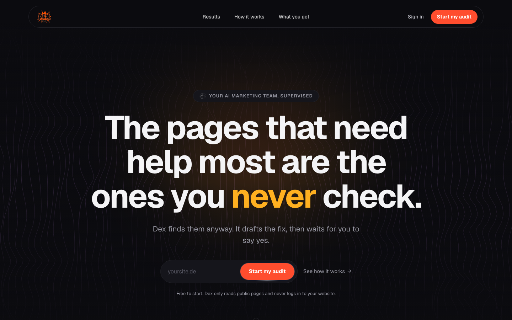

  

<h1 align="center">Dex</h1>

<em>your AI marketing team, supervised.</em>

<h3 align="center">The pages that need help most are the ones you never check.</h3>

  Dex finds them anyway. It reads your site the way Google and ChatGPT do, drafts the fix, checks its own work,
  and then waits for your yes. Nothing goes out without you.

  
  
  
  

<a href="#why">Why</a> · <a href="#how-it-works">How it works</a> · <a href="#what-you-get">What you get</a> · <a href="#the-safety-gate">The safety gate</a> · <a href="#honest-notes">Honest notes</a> · <a href="#access">Access</a>

---

## Why

Every business has the same marketing to-do list that never gets done: the page with no title, the product with
no description, the service ChatGPT cannot explain when a customer asks about it. In a world where AI decides who
gets found, those quiet gaps cost customers every day, and nobody has time to hunt them down.

**Dex gives every business a marketing team it stays in charge of.**

## How it works

| Step | What Dex does | What you do |
|---|---|---|
| **1. Scan** | Reads every public page of your site, like a search engine would | Paste your URL |
| **2. Flag** | Finds what costs you visibility: missing titles, weak descriptions, gaps AI search cannot answer | Nothing |
| **3. Draft** | Writes the fix in your brand's voice | Nothing |
| **4. Review** | Runs five checks on its own draft, then waits | Approve, edit or reject |

## What you get

- **A daily to-do list that does itself.** Each finding arrives with the fix already written.
- **Found on Google and in ChatGPT.** Fixes target classic search and AI answers together.
- **Your voice, not template copy.** Drafts learn from your own pages, so they sound like you.
- **A record of every decision.** Who approved what, when, and why, in one log you can show anyone.

## The safety gate

Before any draft reaches you, Dex checks it five ways: AI content labelled, every claim backed, consistent with
your existing copy, the right length, not a duplicate. A draft that fails a check is held back, not sent. You
always make the final call.

## Honest notes

- **Dex never logs in to your website** and never publishes on its own. You copy an approved fix into your site
  yourself, which keeps you in control of every word.
- **It reads public pages only.** Nothing behind a login, nothing private.
- **Early access.** Dex is live and improving every week; expect the product to move fast.

## Access

Start with a free audit at **[dex-ai-plum.vercel.app](https://dex-ai-plum.vercel.app)**. Paste your URL and see
what Dex finds.

  

For partnerships, agencies or press, reach out through [GitHub](https://github.com/SuryaThakur999).

## Also by Surya

**[Yoki.AI](https://github.com/SuryaThakur999/yoki-ai)**: your accountant gives you the numbers, Yoki tells you what they mean next. Cash, VAT and tax-threshold radar for German founders.

---

This repository is a product showcase and contains no source code. Dex is proprietary software, all rights
reserved. See [LICENSE](LICENSE).
